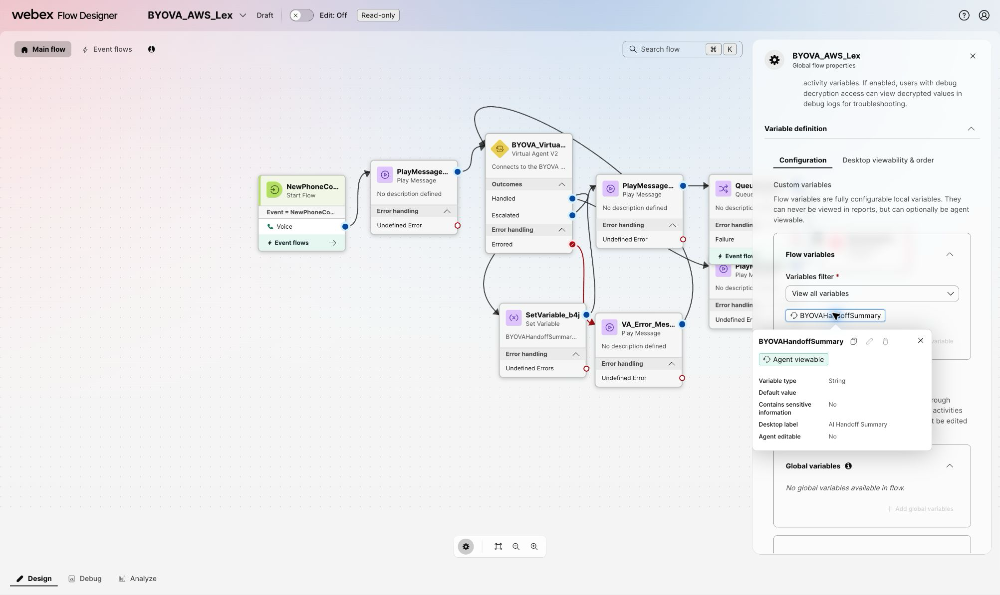
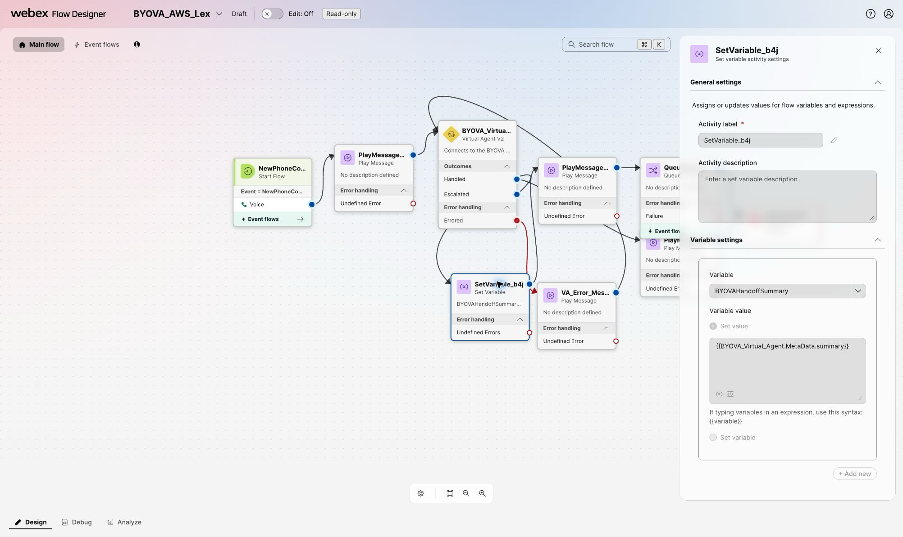
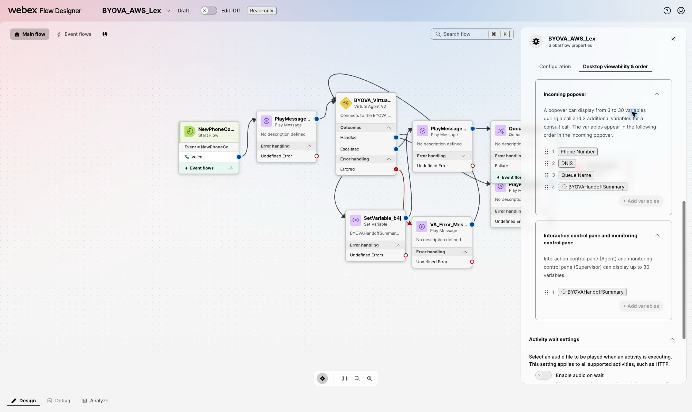
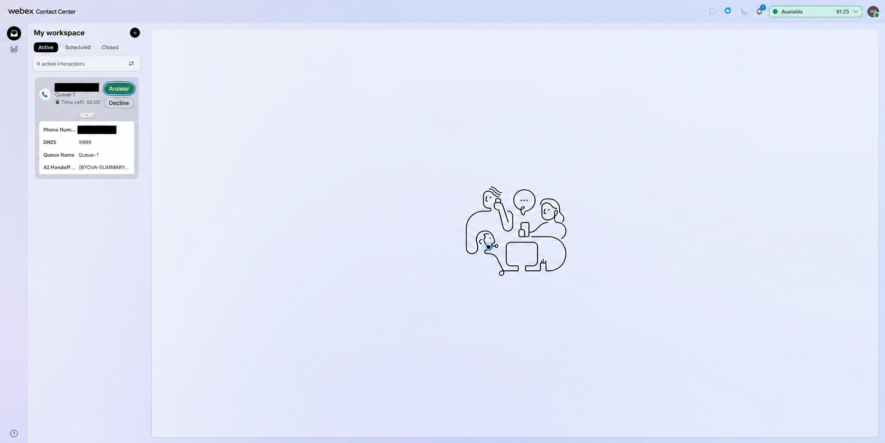
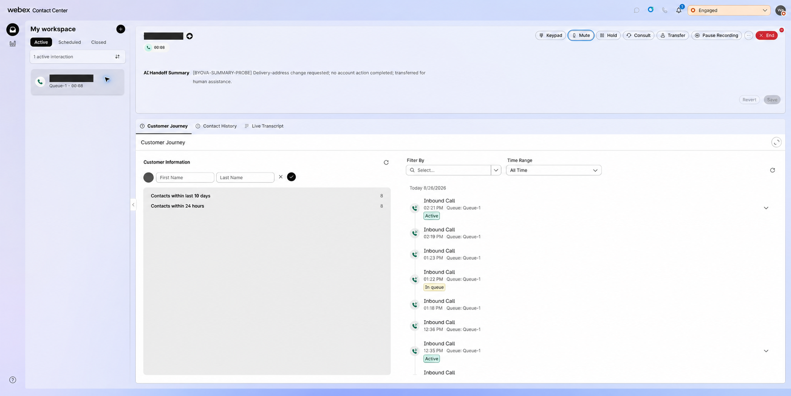

# Passing a Virtual-Agent Handoff Summary to Webex Contact Center

This document defines a provider-neutral contract for passing a handoff summary from a
BYOVA virtual agent to Webex Contact Center (WxCC) when the call transfers to a human agent.
The goal is to let the receiving agent understand the caller's request without asking the
caller to repeat it.

The contract applies to any virtual-agent provider and to both WxCC-facing transports:
gRPC and WebSocket. Each connector remains responsible for translating its provider's
terminal response into the canonical gateway fields described below. The provider connection
can use a different transport from the WxCC connection.

## Intended Agent Experience

When the virtual agent escalates a call, the human agent should receive a concise handoff
summary:

- In the incoming-interaction popover before answering
- In the Interaction Control pane after answering
- Without depending on a provider-specific Agent Desktop widget

This document covers only the handoff summary behavior verified by this implementation.

## Data Flow

```text
Virtual-agent provider
        |
        | provider-specific terminal event and generated summary
        v
Provider connector
        |
        | canonical handoff summary
        v
BYOVA gateway
        |
        | final transfer response over gRPC or WebSocket
        v
WxCC Virtual Agent V2 activity
        |
        | output-event metadata.summary
        v
Agent-viewable flow variable
        |
        +--> incoming-interaction popover
        +--> Interaction Control pane
```

The provider may generate the summary itself or return structured facts from which the
connector builds a summary. The WxCC-facing response must not depend on which approach the
provider uses.

## Canonical Gateway Handoff Summary

Provider connectors should normalize terminal handoff data into one internal shape before
the gateway creates the BYOVA response:

```json
{
  "message_type": "transfer",
  "handoff": {
    "summary": "Caller wants to change the delivery address. The virtual agent did not modify the order. Verify the caller and update the address.",
    "language_code": "en-US"
  }
}
```

`handoff.summary` contains the text intended for the receiving agent. `language_code` is
optional and identifies the language used by the summary.

Connectors should not leak their provider's raw terminal payload into the gateway contract.
They should extract only the approved fields and normalize them into this shape.

## BYOVA Transfer Response

Both transports use the same connector `handoff.summary` and shared conversation processor.
The gateway puts the summary in one terminal `TRANSFER_TO_AGENT` event and in
`session_summary`; the WebSocket adapter serializes those fields into JSON.

| WxCC-facing transport | Where the handoff fields are sent | Completion |
| --- | --- | --- |
| gRPC | A `VoiceVAResponse` on the current `ProcessCallerInput` response stream | Send the terminal `FINAL`, then complete the RPC normally |
| WebSocket | The `payload` of a `VOICE_VA_RESPONSE` JSON envelope on the existing `/v1/va` connection | Send and flush the terminal `FINAL`, then wait for WxCC to close the socket; the gateway bounds that wait |

### gRPC

Use the configured [gRPC listener and datasource](../README.md#grpc).
Return one final `VoiceVAResponse` containing one `TRANSFER_TO_AGENT` output event. The
following JSON-style pseudocode shows the handoff fields; the gRPC wire message is protobuf,
with no WebSocket envelope:

```json
{
  "response_type": "FINAL",
  "session_summary": {
    "text": "Caller wants to change the delivery address. The virtual agent did not modify the order. Verify the caller and update the address.",
    "language_code": "en-US"
  },
  "output_events": [
    {
      "event_type": "TRANSFER_TO_AGENT",
      "name": "transfer_requested",
      "metadata": {
        "summary": "Caller wants to change the delivery address. The virtual agent did not modify the order. Verify the caller and update the address."
      }
    }
  ]
}
```

### WebSocket

Enable and register the WebSocket listener using the separate WebSocket datasource and a
WebSocket-capable connector as described in [BYOVA WebSocket Transport](WEBSOCKET_TRANSPORT.md).
The shared connector handoff contract above also applies when WxCC connects over WebSocket.

The gateway sends a JSON text frame on the call's existing `/v1/va` connection. The handoff
fields go inside `payload`, with the same `conversation_id`, the next gateway-owned `seq`,
and an RFC 3339 `ts`. For example, this event-only terminal response carries a summary:

```json
{
  "type": "VOICE_VA_RESPONSE",
  "seq": 27,
  "ts": "2026-11-16T15:00:00Z",
  "conversation_id": "example-call-123",
  "payload": {
    "response_type": "FINAL",
    "session_summary": {
      "text": "Caller wants to change the delivery address. The virtual agent did not modify the order. Verify the caller and update the address."
    },
    "output_events": [
      {
        "event_type": "TRANSFER_TO_AGENT",
        "name": "transfer_requested",
        "metadata": {
          "summary": "Caller wants to change the delivery address. The virtual agent did not modify the order. Verify the caller and update the address."
        }
      }
    ]
  }
}
```

The sequence number and timestamp are illustrative; the gateway assigns them at runtime.
When the connector streams a spoken transfer announcement, send its audio `CHUNK` responses
before the terminal `FINAL` containing the transfer event and summary. Keep the summary on
that terminal response. After flushing it, the gateway waits for WxCC to close the socket
instead of closing immediately and risking loss of the handoff.

### Summary fields in both transports

The fields serve different purposes. For WebSocket, both are inside `payload`:

| Field | Purpose | Requirement |
| --- | --- | --- |
| `output_events[].metadata.summary` | Makes the summary available to the WxCC flow as transfer metadata | Required for the validated Agent Desktop path |
| `session_summary` | Uses the dedicated BYOVA session-summary field | Recommended when a summary is available |

The summary is intentionally present in both `session_summary` and transfer metadata. The
dedicated field preserves the BYOVA semantic model, while `metadata.summary` supports the
current WxCC flow-variable and Agent Desktop path.

The relevant protocol definitions are:

- [`VoiceVAResponse.session_summary`](../proto/voicevirtualagent.proto)
- [`OutputEvent.TRANSFER_TO_AGENT` and `metadata`](../proto/byova_common.proto)
- [WebSocket envelope and response schemas](../schemas/websocket/README.md)

## WxCC Flow Mapping

Use the same Flow Designer configuration for gRPC and WebSocket. The WebSocket JSON
`payload` wrapper is a transport detail; do not add it to the Flow Designer expression.

In Flow Designer, the Virtual Agent V2 activity exposes transfer-event metadata through its
`MetaData` output. Map the normalized `summary` key to a custom String flow variable:

```text
BYOVAHandoffSummary = {{BYOVA_Virtual_Agent.MetaData.summary}}
```

The Virtual Agent activity name is flow-specific; replace `BYOVA_Virtual_Agent` with the
actual activity name. Configure the custom variable as:

| Setting | Value |
| --- | --- |
| Type | String |
| Desktop label | AI Handoff Summary |
| Agent viewable | Enabled |
| Agent editable | Disabled |

These settings live in the flow's **Global flow properties**. They do not require a custom
Agent Desktop JSON layout.

### 1. Create the agent-viewable variable

Open **Variable definition > Configuration**, create the String variable, and leave its
default value empty. The summary must be designed to exclude secrets, payment data, and other
content that should not appear in an incoming offer. The following nonproduction example uses
synthetic, non-sensitive content.



### 2. Copy the transfer metadata into the variable

On the Virtual Agent V2 **Escalated** branch, add a **Set Variable** activity before the
activity that queues the contact for a human agent. Select `BYOVAHandoffSummary`, choose
**Set value**, and enter the metadata expression shown above. Use the flow's actual Virtual
Agent activity name in the expression.



The surrounding nodes in this screenshot belong to a nonproduction example flow. The
provider-neutral requirement is the selected variable and expression, not the example's
activity names or other branches.

Keep the human-routing path independent of the optional value:

- Connect the Set Variable success path to the normal human queue path.
- If the flow treats a missing nested `summary` key as an **Undefined Error**, connect that
  error path to the same human queue path, or guard the assignment with an equivalent
  condition.
- Do not disconnect the contact or send it to a Virtual Agent failure branch only because
  the summary is absent.
- Do not invent a fallback summary. Leave the agent-viewable variable empty when no summary
  was supplied.

### 3. Select the Agent Desktop surfaces

Open **Variable definition > Desktop viewability & order**. Add
`BYOVAHandoffSummary` to both **Incoming popover** and **Interaction control pane and
monitoring control pane**, then place it in the desired order. Publish the flow after the
configuration has been validated.



The transfer must continue when the provider does not supply a summary; an absent summary is
not a routing failure.

## Validated Agent Desktop Behavior

The following screenshots were captured in a nonproduction WxCC organization with synthetic
handoff content. They prove the WxCC metadata-to-flow-variable-to-desktop path. They do not
prove that any specific provider generates a summary automatically.

### Before the agent answers

The incoming-interaction popover includes **AI Handoff Summary** with the other request
details. The narrow popover may truncate a long value, so the summary should lead with the
caller's request and requested next action.



### After the agent answers

The full summary appears at the top of the active interaction, directly below the call
controls.



The synthetic marker in these screenshots was added by a development-only terminal insight
probe. A production implementation must replace that probe with provider-neutral handoff
normalization and pass-through.

### WebSocket validation status

The shared mapping is implemented for WebSocket. The [WebSocket live-testing notes](WEBSOCKET_LIVE_TESTING.md)
record a transfer with forwarded summary metadata, but leave the Flow Designer variable
read-back and staffed-agent Desktop check outstanding. The screenshots above establish the
existing Desktop mapping; they do not establish a separate WebSocket end-to-end pass.

## Gateway Requirements

The production gateway implementation should:

1. Accept a normalized handoff summary from every connector that can provide one.
2. Create exactly one terminal `TRANSFER_TO_AGENT` output event.
3. Copy the summary into that event's `metadata.summary` field.
4. Populate `session_summary` with the same text and language when available.
5. Allowlist supported metadata fields rather than forwarding an arbitrary provider payload.
6. Enforce configured size limits and valid scalar types.
7. Never write summary content to logs, metrics, traces, or error messages.
8. Preserve transfer behavior when the summary is missing, malformed, or too large.

The gateway should log only safe operational facts such as whether a field was present, its
character count, the selected language, and whether validation accepted or omitted it.

## Summary Content Guidance

A useful handoff summary should be factual, brief, and ordered for the receiving agent. It
should include:

- Why the caller contacted the virtual agent
- Important information the caller supplied
- Actions the virtual agent completed or explicitly did not complete
- The reason for escalation
- The next action expected from the human agent

Do not include credentials, authentication tokens, payment data, unnecessary sensitive
personal information, unsupported conclusions, or hidden provider diagnostics. Prefer plain
text over Markdown because the Agent Desktop variable is rendered as text.

## Verification

Automated coverage should verify:

- A transfer with a summary creates one transfer event containing `metadata.summary`.
- The same value appears in `session_summary`.
- A transfer without a summary still succeeds.
- Non-transfer responses do not receive handoff fields.
- Oversized or invalid values are omitted or truncated according to configuration.
- Summary text does not appear in logs.
- Provider-specific fields do not escape the connector boundary.

Run these end-to-end acceptance checks separately for each WxCC-facing transport you enable:

1. The provider or test connector produces a synthetic handoff summary.
2. The gateway emits a final response with one `TRANSFER_TO_AGENT` event: a protobuf
   `VoiceVAResponse` for gRPC or a `VOICE_VA_RESPONSE` JSON envelope for WebSocket.
3. The WxCC flow assigns `MetaData.summary` to the agent-viewable variable.
4. The incoming offer shows the summary before answer.
5. The active interaction shows the full summary after answer.
6. The call routes and completes normally when the summary is absent.

Use synthetic content for all nonproduction validation. Disable any terminal test probe after
the test and restore the environment's approved gateway release.
